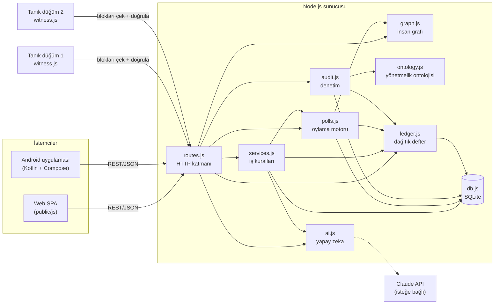
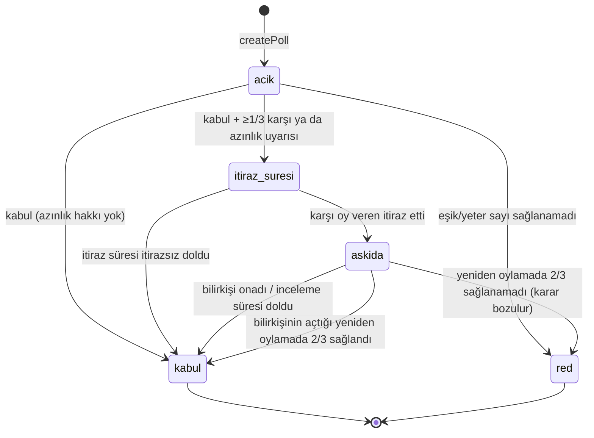

# Ortak Akıl — Yazılım Mühendisliği İlkeleri ve Tasarım Desenleri Raporu

Bu rapor, Ortak Akıl projesinin hangi yazılım mühendisliği ilkelerine **nasıl** uyduğunu ve hangi tasarım
desenlerini (design pattern) **nerede** kullandığını kod üzerinden gösterir. Her iddia, ilgili dosya ve
satıra bağlantı verilerek desteklenmiştir. Son bölümde projenin bilinen zayıf yönleri de dürüstçe listelenmiştir.

| | |
|---|---|
| **Proje** | Katılımcı karar platformu: web sitesi + Android uygulaması + dağıtık defter |
| **Sunucu** | Node.js 22+, Express 5, SQLite (`node:sqlite`) — ~5.300 satır JavaScript (sunucu + web) |
| **Mobil** | Kotlin, Jetpack Compose, Material 3 — ~3.300 satır Kotlin |
| **Test** | `node:test` ile 10 otomatik kural testi (`npm test`) |

---

## 1. Mimariye genel bakış

Tek bir REST API iki istemciye (web ve Android) hizmet verir; iş kuralları yalnızca sunucuda yaşar.
Böylece "kural iki yerde yazılır, biri unutulur" riski ortadan kalkar.

| Katman | Sorumluluk | Dosyalar |
|---|---|---|
| Sunum (web) | Sayfa çizimi, kullanıcı etkileşimi | [`public/js/pages/*`](../server/public/js/pages), [`ui.js`](../server/public/js/ui.js) |
| Sunum (mobil) | Compose ekranları, gezinme | [`ui/screens/*`](../android/app/src/main/java/org/ortakakil/app/ui/screens) |
| HTTP / API | Kimlik doğrulama, girdi ayrıştırma, yanıt | [`routes.js`](../server/src/routes.js), [`server.js`](../server/src/server.js) |
| Alan (domain) | Oylama, itiraz, gizleme, bilirkişilik kuralları | [`services.js`](../server/src/services.js), [`polls.js`](../server/src/polls.js) |
| Alan servisleri | Denetim, graf analizi, yapay zeka, ontoloji | [`audit.js`](../server/src/audit.js), [`graph.js`](../server/src/graph.js), [`ai.js`](../server/src/ai.js), [`ontology.js`](../server/src/ontology.js) |
| Altyapı | Kalıcılık, defter, yapılandırma | [`db.js`](../server/src/db.js), [`ledger.js`](../server/src/ledger.js), [`config.js`](../server/src/config.js) |

---

## 2. Yazılım mühendisliği ilkeleri

### 2.1 Sorumlulukların ayrılması (Separation of Concerns) ve katmanlı mimari

Her modül tek bir kaygıyı ele alır ve katmanlar yalnızca alt katmanı çağırır:

- **HTTP katmanı iş kuralı içermez.** [`routes.js`](../server/src/routes.js) yalnızca isteği ayrıştırır ve
  servis fonksiyonunu çağırır; örneğin oy verme uç noktası tek satırlık bir yönlendirmedir.
- **İş kuralları HTTP'den habersizdir.** [`polls.js`](../server/src/polls.js) ve [`services.js`](../server/src/services.js)
  Express nesnesi almaz; aynı fonksiyonlar HTTP rotalarından, demo verisi üreticisinden ([`seed.js`](../server/src/seed.js))
  ve testlerden ([`core.test.js`](../server/test/core.test.js)) aynen çağrılır.
- **Kalıcılık tek yerde.** SQL şeması, tetikleyiciler ve işlem (transaction) yönetimi yalnızca [`db.js`](../server/src/db.js) içindedir.
- **Android'de de aynı ayrım:** ağ katmanı [`Api.kt`](../android/app/src/main/java/org/ortakakil/app/data/Api.kt),
  uygulama durumu [`AppViewModel.kt`](../android/app/src/main/java/org/ortakakil/app/AppViewModel.kt),
  görünüm `ui/screens/*` içindedir.

### 2.2 SOLID

| İlke | Projede nasıl uygulandı | Değerlendirme |
|---|---|---|
| **S — Tek sorumluluk** | `ledger.js` yalnızca zincir yazar/doğrular; `graph.js` yalnızca graf analizi yapar; `audit.js` yalnızca denetler; `ontology.js` yalnızca alan modelini ve Turtle dışa aktarımını tutar. | Güçlü. İstisna: `services.js` (633 satır) birden çok alt alanı bir arada tutuyor (bkz. §6). |
| **O — Açık/kapalı** | Yeni bir yönetmelik maddesi eklemek için [`ARTICLES`](../server/src/ontology.js#L89) dizisine bir kayıt ve [`CHECKS`](../server/src/audit.js#L20) haritasına bir kural fonksiyonu eklemek yeterli; denetim motoru (`runAudit`) değişmez. Gizleme gerekçeleri ve konu türleri de veri olarak tanımlıdır ([`DELETION_CATEGORIES`](../server/src/ontology.js#L30), [`TOPIC_KINDS`](../server/src/ontology.js#L23)). | Kısmen. Oylama sonucunun etkisini uygulayan [`applyOutcome`](../server/src/polls.js#L177) bir `switch` kullanır; yeni oylama türü eklemek bu fonksiyonu değiştirmeyi gerektirir. |
| **L — Liskov yerine geçme** | Kalıtım az ve sığdır: [`HttpError`](../server/src/util.js#L19) `Error`'ın, `ApiException` `Exception`'ın yerine her yerde kullanılabilir; hata işleyiciler temel türü yakalar. | Uygun (kalıtım bilinçli olarak az kullanıldı). |
| **I — Arayüz ayrımı** | Modüller küçük ve amaca özel fonksiyonlar dışa aktarır (ör. `ledger.js`: `append`, `verify`, `verifyChain`, `tallyFromLedger`). Tanık düğüm, defter modülünden yalnızca `verifyChain` ve `merkleRoot`'u kullanır. Compose bileşenleri yalnızca ihtiyaç duydukları veriyi parametre alır. | Uygun. |
| **D — Bağımlılıkların tersine çevrilmesi** | Yapay zeka sağlayıcısı soyutlanmıştır: çağıranlar `classifyTopic`/`summarizeDiscussion` gibi alan fonksiyonlarını kullanır, Claude mı yerel çözümleyici mi çalıştığını bilmez ([`run`](../server/src/ai.js#L60)). Android'de `Api` ve `AppViewModel`, `CompositionLocal` ile enjekte edilir ([`LocalApp`](../android/app/src/main/java/org/ortakakil/app/ui/Components.kt#L79)). | Kısmen. Sunucu modülleri somut `db` tekilini (singleton) doğrudan içe aktarır; bir DI konteyneri yoktur. |

### 2.3 DRY — Kendini tekrar etme

- **Tek API, iki istemci:** web ve Android aynı REST uç noktalarını kullanır; oylama eşiği, seçmen kütüğü,
  itiraz hakkı gibi kurallar yalnızca sunucuda bir kez yazılmıştır. İstemciler `canVote`, `canAppeal`,
  `canReview` gibi hazır kararları sunucudan alır ([`pollView`](../server/src/polls.js#L344)).
- **Tek doğrulama fonksiyonu, iki kullanıcı:** [`verifyChain`](../server/src/ledger.js#L53) hem birincil düğümün
  kendi doğrulamasında hem de [tanık düğümde](../server/src/witness.js#L86) kullanılır.
- **Tek karar fonksiyonu:** [`evaluate`](../server/src/polls.js#L70) hem erken kararı hem kapanıştaki kesin kararı hesaplar;
  denetim motoru da aynı eşik mantığını yeniden kontrol eder.
- **Ortak bileşenler:** web'de `tallyBar`, `badge`, `openModal` ([`ui.js`](../server/public/js/ui.js));
  Android'de `TallyBar`, `VoteButtons`, `FormDialog`, `Loadable` ([`Components.kt`](../android/app/src/main/java/org/ortakakil/app/ui/Components.kt)).

### 2.4 KISS ve YAGNI — Basit tut, gerekmeyeni yapma

- Web arayüzü **derleme adımı gerektirmez**: tarayıcıya doğrudan ES modülleri olarak sunulur; React, webpack vb. yoktur.
- Veritabanı için harici bir sunucu ya da yerel derleme gerektiren paket yerine Node'un yerleşik `node:sqlite` modülü kullanılır.
- Sunucunun yalnızca iki çalışma zamanı bağımlılığı vardır: `express` ve `@anthropic-ai/sdk`.
- Android'de Retrofit/Moshi yerine platformla gelen `HttpURLConnection` ve `org.json` kullanılmıştır.
- Graf yerleşimi ve topluluk tespiti için kütüphane eklenmemiş, kısa ve okunur algoritmalar yazılmıştır
  ([etiket yayılımı](../server/src/graph.js#L16), [PageRank](../server/src/graph.js#L50)).

### 2.5 Hızlı başarısızlık (Fail Fast) ve tutarlı hata yönetimi

- İş kuralı ihlalleri anında, anlamlı bir HTTP durum koduyla fırlatılır: [`fail(status, mesaj)`](../server/src/util.js#L26).
  Örnek: seçmen kütüğü dışındaki oy `403`, kapanmış oylama `409`, geçersiz gerekçe `400`.
- Tüm hatalar tek bir merkezi işleyicide JSON'a çevrilir ([`server.js`](../server/src/server.js#L30)).
- Kayıt formu tüm alan hatalarını tek seferde döndürür; web ve Android bunları ilgili alanın altında gösterir.

### 2.6 Derinlemesine savunma (Defense in Depth) ve güvenlik

Kritik kurallar **birden fazla katmanda** korunur:

| Kural | Uygulama katmanı | Veritabanı katmanı | Bağımsız doğrulama |
|---|---|---|---|
| Tartışma mesajı silinemez | Silme uç noktası yok | [`messages_no_delete` tetikleyicisi](../server/src/db.js#L231) | Denetim R7: defterdeki her mesaj özeti veritabanında olmalı |
| Mesaj değiştirilemez | Düzenleme uç noktası yok | [`messages_immutable`](../server/src/db.js#L234) | Denetim R7: içerik özeti karşılaştırması |
| Gizleme yalnızca oylamayla | `applyOutcome` | [`messages_hide_needs_poll`](../server/src/db.js#L242) | Denetim R8 |
| Defter değiştirilemez | Yalnızca `append` | [`ledger_no_update/delete`](../server/src/db.js#L246) | Zincir doğrulama + tanık düğümler |

Diğer güvenlik önlemleri:
- Parolalar `scrypt` + rastgele tuz ile saklanır, karşılaştırma zamanlama saldırısına karşı `timingSafeEqual` ile yapılır ([`util.js`](../server/src/util.js#L44)).
- Giriş ve kayıt uç noktalarında hız sınırlama vardır ([`limit`](../server/src/routes.js#L31)).
- Web arayüzünde kullanıcı içeriği **varsayılan olarak kaçışlanır**: `html` etiketli şablonu, yalnızca açıkça
  güvenli işaretlenmiş (`Safe`) değerleri ham ekler ([`ui.js`](../server/public/js/ui.js#L4)). Bu, XSS'i yapısal olarak önler.
- Oylamaya sonradan açılan hesaplarla katılım engellenir (seçmen kütüğü dondurma, [`castVote`](../server/src/polls.js#L97)).

### 2.7 Tasarımla gizlilik (Privacy by Design — KVKK)

- Kişisel veriler yalnızca sahibine döner: [`privateUser`](../server/src/services.js#L91) ile [`publicUser`](../server/src/services.js#L97)
  ayrı görünümlerdir; kamuya yalnızca takma ad gösterilir.
- Deftere kişisel veri yazılmaz; üye kaydında yalnızca HMAC'lenmiş kimlik özeti yazılır ([`register`](../server/src/services.js#L18)).
  Bu kural denetim R2 tarafından da kontrol edilir.
- Oylar deftere oylamaya özgü takma kimlikle yazılır: herkes sonucu defterden yeniden sayabilir ama kimin ne oy verdiğini göremez.
- "Kişisel veri" gerekçesiyle gizlenen mesajın içeriği boşaltılır (unutulma hakkı), ancak özeti kalır; böylece bütünlük kanıtı bozulmaz.

### 2.8 Değiştirilemezlik ve denetlenebilirlik (Auditability)

Sistem "ne oldu?" sorusunu **sonradan kanıtlanabilir** biçimde yanıtlar:
- Her durum değişikliği (üye kaydı, konu önerisi, oy, sonuç, itiraz, şerh…) defterde imzalı bir bloğa dönüşür ([`append`](../server/src/ledger.js#L31)).
- Oylama sonuçları yalnızca defterden bağımsız olarak yeniden sayılabilir ([`tallyFromLedger`](../server/src/ledger.js#L124)); web ve Android bu sayımı veritabanıyla karşılaştırıp gösterir.
- Yönetmeliğin her maddesi makinece denetlenir ([`runAudit`](../server/src/audit.js#L203)); konu bazlı denetim de vardır ([`auditTopic`](../server/src/audit.js#L219)).

### 2.9 Zarif bozulma (Graceful Degradation) ve dayanıklılık

- Yapay zeka erişilemezse (anahtar yok, ağ hatası, hız sınırı) sistem **çökmez**; yerel kural tabanlı
  çözümleyiciye düşer ve yanıtta kaynağı ile uyarıyı belirtir ([`run`](../server/src/ai.js#L60)).
- Claude bir isteği güvenlik gerekçesiyle reddederse sunucu tarafı yedek model devreye girer ([`fallbacks: 'default'`](../server/src/ai.js#L49)).
- Yapay zeka çağrıları kullanıcıyı bekletmez: mesaj önce yerel denetimle kaydedilir, Claude değerlendirmesi arka planda gelince güncellenir ([`postMessage`](../server/src/services.js#L345)).
- Tanık düğüm erişilemezse uzlaşı raporu "erişilemiyor" der; birincil düğüm çalışmaya devam eder.
- Android'de bağlantı yoksa uygulama çökmeden sunucu adresi ekranına düşer.

### 2.10 Test edilebilirlik

- **Zaman soyutlaması:** tüm iş kuralları `Date.now()` yerine `now()` kullanır; testler ve demo verisi saati ileri/geri alabilir ([`setClock`](../server/src/util.js#L6)). Böylece "24 saatlik müzakere süresi" gibi kurallar saniyeler içinde test edilir.
- **Bellek içi veritabanı:** testler `initDb(':memory:')` ile izole çalışır.
- **Saf fonksiyonlar:** `evaluate`, `verifyChain`, `merkleRoot`, `classifyLocal`, `moderateLocal` yan etkisizdir ve doğrudan test edilebilir.

### 2.11 Dışsallaştırılmış yapılandırma (12-Factor)

Port, veritabanı yolu, oylama süreleri, yeter sayı, tanık düğüm sayısı ve yapay zeka modu kodda sabit değil;
ortam değişkenleri ve komut satırı bayraklarıyla değiştirilir ([`config.js`](../server/src/config.js#L13)).
`npm run demo` aynı kodu yalnızca yapılandırmayı değiştirerek "sunum modunda" çalıştırır.

### 2.12 Ortak alan dili (Ubiquitous Language — DDD)

Koddaki adlar, gereksinimlerde ve derste kullanılan Türkçe kavramlarla birebir aynıdır: `seçmen kütüğü`,
`itiraz_suresi`, `askida`, `azınlık şerhi`, `bilirkişi`, `yeter sayı`. Ontoloji sınıfları (`oa:Konu`,
`oa:AltKonu`, `oa:SilmeTalebi`…) aynı sözlüğü makinece okunur hale getirir ([`CLASSES`](../server/src/ontology.js#L46)).
Bu, gereksinim ile kod arasındaki çeviri hatasını azaltır.

### 2.13 İşlem bütünlüğü (ACID)

Bir iş adımı birden fazla tabloyu değiştiriyorsa (ör. konu + oylama + defter bloğu) tek bir işlemde yapılır.
[`db.tx`](../server/src/db.js#L274) iç içe çağrılabilir; içteki çağrılar dıştaki işleme katılır, hata olursa tümü geri alınır.

---

## 3. Tasarım desenleri

### 3.1 Özet tablo

| Desen | Tür | Nerede |
|---|---|---|
| Katmanlı mimari | Mimari | Sunucu: routes → services/polls → db |
| Front Controller + Router | Mimari | Express `api` yönlendiricisi; web'de [`routes` tablosu](../server/public/js/app.js#L10); Android `NavHost` |
| MVVM + tek yönlü veri akışı | Mimari | Android: `AppViewModel` + Compose |
| Chain of Responsibility (Middleware) | Davranışsal | Express: kimlik → hız sınırı → rota → hata işleyici |
| Strategy | Davranışsal | Yapay zeka sağlayıcısı (Claude / yerel); konu türüne göre eşik |
| Template Method | Davranışsal | `ai.run` iskeleti |
| State (durum makinesi) | Davranışsal | Oylama/konu yaşam döngüsü |
| Observer | Davranışsal | Web `store.js`; Compose durum nesneleri |
| Specification / Rule Object | Davranışsal (DDD) | Denetim kuralları `CHECKS` |
| Facade | Yapısal | `services.js`; Android `Api` |
| Adapter | Yapısal | JSON uzantı fonksiyonları; Turtle/GraphML dışa aktarıcılar |
| Composite | Yapısal | Konu ağacı (konu → alt konu → …) |
| Factory (fabrika fonksiyonu) | Yaratımsal | `createPoll`, `createApp`, `createGraphView` |
| Singleton | Yaratımsal | `db`, defter anahtarları, `AppViewModel` |
| Table Data Gateway | Kurumsal | `db.js` sarmalayıcısı |
| Unit of Work | Kurumsal | `db.tx` |
| Cache-Aside | Kurumsal | Yapay zeka sonuç önbelleği |
| Event Log / Event Sourcing (kısmi) | Kurumsal | Defter + defterden yeniden sayım |
| Hash zinciri + Merkle ağacı + Tanık/Replika | Dağıtık sistem | `ledger.js`, `witness.js` |
| Module (closure) | JavaScript deyimi | `graph-view.js` |
| Service Locator / Ambient Context | Yaratımsal | Compose `CompositionLocal` |
| Sealed state + Render Props | Kotlin/Compose deyimi | `LoadState` + `Loadable` |
| Veri güdümlü tasarım (Table-driven) | Genel | `ARTICLES`, `CHECKS`, `POLL_KINDS`, rota tabloları |

### 3.2 Ayrıntılar

#### State — Oylama yaşam döngüsü

Bir oylama, iyi tanımlı durumlar arasında yalnızca izin verilen geçişlerle ilerler. Geçişler
[`finalize`](../server/src/polls.js#L127), [`tick`](../server/src/polls.js#L236), [`fileAppeal`](../server/src/polls.js#L266)
ve [`resolveAppeal`](../server/src/polls.js#L305) içinde merkezîdir; konunun/teklifin durumu
[`setSubjectStatus`](../server/src/polls.js#L156) ile oylamanın durumunu yansıtır.

> Bilirkişi "yeniden oylama" kararı verdiğinde 2/3 eşikli ayrı bir `itiraz` oylaması açılır; asıl oylama
> o oylama sonuçlanana kadar `askida` kalır.
>
> Not: GoF'taki "her durum ayrı sınıf" biçimi yerine açık bir durum makinesi (durum alanı + geçiş fonksiyonları)
> tercih edilmiştir; durum sayısı az olduğu için bu daha okunurdur (KISS).

#### Strategy + Template Method — Yapay zeka

[`run(kind, input, claudeFn, localFn)`](../server/src/ai.js#L60) her yapay zeka özelliği için aynı iskeleti uygular
(**Template Method**): önbelleğe bak → sağlayıcıyı seç → çağır → hata olursa yedeğe düş → önbelleğe yaz.
Değişen kısım, parametre olarak verilen iki **strateji** fonksiyonudur: Claude çağrısı ya da yerel çözümleyici.
Hangi stratejinin seçileceği yapılandırmaya bağlıdır ([`claudeEnabled`](../server/src/ai.js#L13)). Özetleme,
sınıflandırma, moderasyon ve gizleme değerlendirmesi bu tek iskeleti paylaşır.

Konu türüne göre eşik de bir stratejidir: genel konu "yarıdan fazla", yönetmelik konusu "en az 2/3"
([`TOPIC_KINDS`](../server/src/ontology.js#L23)); oylama motoru hangi eşikle çalıştığını bilmeden [`meets`](../server/src/polls.js#L65) ile karar verir.

#### Specification / Rule Object — Denetim motoru

Her yönetmelik maddesi, [`ARTICLES`](../server/src/ontology.js#L89) içinde bir `rule` kimliği taşır
(R1…R16). [`CHECKS`](../server/src/audit.js#L20) haritası bu kimlikleri, "sistem bu maddeye uyuyor mu?"
sorusunu yanıtlayan bağımsız kural nesnelerine eşler. [`runAudit`](../server/src/audit.js#L203) kuralları
tek tip bir arayüzle (`{kontrol, ihlaller, uyarilar}`) çalıştırır. Bir kural çökerse yalnızca o madde
"ihlal" olarak raporlanır, diğerleri etkilenmez.

#### Chain of Responsibility — Express ara katmanları

Bir istek sırayla şu halkalardan geçer: oturum anahtarını çözen ara katman ([`routes.js`](../server/src/routes.js#L17)) →
gerekirse `auth` ([`L24`](../server/src/routes.js#L24)) → gerekirse `limit` ([`L31`](../server/src/routes.js#L31)) →
rota işleyicisi → bulunamadı işleyicisi ([`L196`](../server/src/routes.js#L196)) → merkezi hata işleyici.
Her halka ya isteği işler ya da bir sonrakine iletir.

#### Facade — Servis katmanı ve Android `Api`

[`services.js`](../server/src/services.js) dış dünyaya "konu oluştur", "mesaj gönder", "gizleme talep et" gibi
yüksek seviyeli işlemler sunar; içeride oylama motorunu, defteri, yapay zekayı ve veritabanını koordine eder.
Örneğin [`createTopic`](../server/src/services.js#L159) tek çağrıda doğrulama, sınıflandırma, konu kaydı, sürüm,
defter bloğu ve oylama oluşturmayı yapar. Android'de [`Api`](../android/app/src/main/java/org/ortakakil/app/data/Api.kt#L35)
sınıfı HTTP ayrıntılarını (başlıklar, kodlama, hata çevirisi, iş parçacığı) gizleyen bir cephedir.

#### Observer

- Web: [`store.js`](../server/public/js/store.js#L4) dinleyici kaydı (`onChange`) ve yayın (`emit`) sağlar; oturum
  değiştiğinde üst menü kendini yeniden çizer.
- Android: `AppViewModel` içindeki `mutableStateOf` alanları ([`L27-31`](../android/app/src/main/java/org/ortakakil/app/AppViewModel.kt#L27))
  gözlemlenebilir durumdur; Compose bu alanlara abone olur ve değiştiklerinde yalnızca ilgili ekranı yeniden çizer.
- Alan düzeyinde: oylama sonuçlandığında, itiraz açıldığında, mesaja yanıt geldiğinde ilgili kişilere bildirim üretilir.

#### Composite — Konu ağacı

Konular `parent_id` ile ağaç oluşturur; alt konu da bir konudur ve kendi alt konularına sahip olabilir.
[`topicTree`](../server/src/services.js#L247) ağacı özyinelemeli kurar; web'deki `treeView` aynı yapıyı
özyinelemeli çizer. İstemci yaprak ile dal arasında ayrım yapmadan aynı arayüzle çalışır.

#### Factory

- [`createPoll`](../server/src/polls.js#L27): her oylama türünü (konu, alt konu, düzenleme, gizleme, bilirkişi,
  itiraz) aynı kurallarla oluşturur: seçmen kütüğünü dondurur, süreleri hesaplar, defter bloğunu yazar, bildirim gönderir.
- [`createApp`](../server/src/server.js#L14): Express uygulamasını kurup döndürür; sunucuyu başlatmadan test edilebilir.
- [`createGraphView`](../server/public/js/graph-view.js#L2): bir canvas için graf görünümü üretir ve yalnızca
  `setEdgeTypes`, `select`, `fit`, `destroy` metotlarını dışa açar (**Module** deseni; iç durum kapanış içinde gizlidir).

#### Singleton

- Veritabanı bağlantısı modül düzeyinde tektir ([`db`](../server/src/db.js#L294)); defter imza anahtarı bir kez üretilip saklanır.
- Android'de `AppViewModel`, `viewModel()` ile etkinlik ömrü boyunca tektir ve ekran döndürmede korunur.

#### Table Data Gateway + Unit of Work

[`db.js`](../server/src/db.js) ham SQLite bağlantısını `all/get/run/tx` arayüzüyle sarmalar, hazırlanmış
sorguları önbelleğe alır ve `undefined/boolean` dönüşümlerini merkezileştirir (**Gateway**).
[`tx`](../server/src/db.js#L274) bir iş adımındaki tüm değişiklikleri tek bir birim olarak işler ya da geri alır (**Unit of Work**).

#### Cache-Aside

Yapay zeka sonuçları, girdinin kanonik JSON'undan üretilen bir anahtarla `ai_cache` tablosunda tutulur
([`run`](../server/src/ai.js#L60)). Aynı tartışma ikinci kez özetlenirken API çağrısı yapılmaz. Başarısız
(yedeğe düşmüş) sonuçlar önbelleğe yazılmaz; böylece servis düzelince gerçek sonuç alınır.

#### Event Log / Event Sourcing (kısmi) ve dağıtık doğrulama

- Defter, sistemdeki olayların yalnızca eklenebilir (append-only) kaydıdır. Oylama sonucu, yalnızca bu olaylardan
  yeniden hesaplanabilir ([`tallyFromLedger`](../server/src/ledger.js#L124)). Tam Event Sourcing değildir (uygulama
  durumu ayrıca tablolarda tutulur), ancak defter durumun **doğrulanabilir kanıtı** rolündedir.
- **Hash zinciri:** her blok bir öncekinin özetini içerir ([`blockHash`](../server/src/ledger.js#L29)); araya
  müdahale tüm zinciri bozar.
- **Merkle ağacı:** tüm blok özetleri tek bir köke indirgenir ([`merkleRoot`](../server/src/ledger.js#L81)); tanık
  düğüm, birincilin geçmişini tek bir karşılaştırmayla doğrular ([`witness.js`](../server/src/witness.js#L72)).
- **Tanık / Replika:** bağımsız süreçler zinciri kopyalar, imzaları doğrular, imza anahtarını ilk görüşte sabitler
  (trust-on-first-use) ve tahrifatı kalıcı olarak işaretler ([`flagTamper`](../server/src/witness.js#L42)).

#### Android'e özgü desenler

- **MVVM + tek yönlü veri akışı:** durum ViewModel'den ekrana akar, olaylar (oy ver, giriş yap) ekrandan ViewModel'e/API'ye gider.
- **Ambient Context / Service Locator:** `LocalApp` ve `LocalNav` ([`Components.kt`](../android/app/src/main/java/org/ortakakil/app/ui/Components.kt#L79)),
  [`OrtakAkilApp`](../android/app/src/main/java/org/ortakakil/app/ui/Navigation.kt#L80) içinde sağlanır; derin ekranlar bağımlılıkları parametre zinciri olmadan alır.
- **Sealed state + Render Props:** [`LoadState`](../android/app/src/main/java/org/ortakakil/app/ui/Components.kt#L234)
  (`Loading / Ok / Err`) yükleme durumlarını tür güvenli ifade eder; [`Loadable`](../android/app/src/main/java/org/ortakakil/app/ui/Components.kt#L242)
  yükleme, hata, yeniden deneme ve "eski veriyi gösterirken yenile" mantığını tek yerde toplar; ekranlar yalnızca başarılı durumu çizer.
- **Uzantı fonksiyonlarıyla Adapter:** `JSONObject.s()/i()/a()` gibi uzantılar ([`Api.kt`](../android/app/src/main/java/org/ortakakil/app/data/Api.kt#L91))
  `org.json`'un null davranışını tutarlı ve güvenli bir arayüze uyarlar.
- **Coroutine ile iş parçacığı ayrımı:** ağ çağrıları `Dispatchers.IO`'da, graf yerleşimi `Dispatchers.Default`'ta
  ([`GraphScreen.kt`](../android/app/src/main/java/org/ortakakil/app/ui/screens/GraphScreen.kt#L144)) çalışır; arayüz kilitlenmez.

---

## 4. Kalite nitelikleri (ISO/IEC 25010 bakışıyla)

| Nitelik | Projedeki karşılığı |
|---|---|
| **Güvenlik** | scrypt parola, zamanlama-güvenli karşılaştırma, hız sınırı, XSS'e karşı varsayılan kaçışlama, DB tetikleyicileri, imzalı defter |
| **Gizlilik** | Kamuya yalnızca takma ad; deftere yalnızca özet; takma kimlikli gizli oy; kişisel veri boşaltma |
| **Denetlenebilirlik** | Her işlem defterde; 16 maddelik otomatik denetim; defterden bağımsız oy sayımı |
| **Güvenilirlik** | ACID işlemler; yapay zeka ve tanık düğüm arızasında zarif bozulma |
| **Bakım kolaylığı** | Katmanlı yapı, küçük modüller, veri güdümlü kurallar, ortak alan dili |
| **Taşınabilirlik** | Derleme gerektirmeyen web; harici veritabanı sunucusu yok; aynı API ile Android |
| **Kullanılabilirlik** | Duyarlı (mobil uyumlu) web, açık/koyu tema, Türkçe arayüz, Material 3 Android |
| **Test edilebilirlik** | Saat soyutlaması, bellek içi veritabanı, saf fonksiyonlar |

---

## 5. Test stratejisi

`npm test` ile çalışan [`core.test.js`](../server/test/core.test.js), gereksinimleri doğrudan doğrulayan
**davranış odaklı** testlerdir (10/10 başarılı):

1. Kayıtta zorunlu alanlar ve yaş sınırı; deftere kişisel veri yazılmaması
2. Asgari müzakere süresinden önce erken karar verilmemesi, sonra çoğunlukla kabul
3. Oylamadan sonra kaydolan üyenin oy kullanamaması (seçmen kütüğü)
4. Herkes oy verdiğinde süre beklenmeden karar; yeter sayı kuralı
5. Alt konunun yalnızca kabul edilmiş konu altında önerilebilmesi
6. Mesajların veritabanı düzeyinde silinememesi ve değiştirilememesi
7. "Görüş ayrılığı" gerekçesinin reddi, 2/3 eşiği ve kişisel veri boşaltma
8. Uçtan uca azınlık koruması: topluluk uyarısı → itiraz → bilirkişi → 2/3 yeniden oylama → kararın bozulması
9. Defter doğrulaması, defterden yeniden sayım ve kurcalamanın tespiti
10. Tüm akışlardan sonra 16 yönetmelik maddesinin denetimden geçmesi

Testler geliştirme sırasında gerçek bir hatayı da yakaladı: itiraz sonrası bozulan bir kararda, daha önce
yazılmış azınlık şerhi yanlışlıkla ihlal sayılıyordu. Kural, şerhin yazıldığı andaki tarafa göre denetlenecek
şekilde düzeltildi ([`audit.js` R14](../server/src/audit.js#L167)).

Web arayüzü tarayıcıda uçtan uca (giriş, oy verme, mesaj, konu oluşturma, itiraz incelemesi, graf) elle test edilmiştir.

---

## 6. Bilinen sınırlamalar ve iyileştirme önerileri

| Konu | Durum | Öneri |
|---|---|---|
| `services.js` büyüklüğü | 633 satır; üyelik, konu, mesaj, bilirkişi ve görünümleri bir arada tutuyor (SRP'ye kısmen aykırı) | `users`, `topics`, `messages`, `experts` servislerine bölmek |
| `applyOutcome` içindeki `switch` | Yeni oylama türü eklemek fonksiyonu değiştirmeyi gerektiriyor (OCP'ye kısmen aykırı) | Tür → işleyici haritası (`{ konu: applyTopic, silme: applyDeletion … }`) |
| Somut `db` tekili | Modüller veritabanını doğrudan içe aktarıyor; paralel testler zorlaşıyor | Depo (repository) nesnelerini parametre olarak geçirmek |
| Android'de tipsiz JSON | Ekranlar `JSONObject` ile çalışıyor; alan adı hataları derleme zamanında yakalanmıyor | `kotlinx.serialization` ile veri sınıfları |
| Android testleri | Uygulama derleniyor; emülatör/cihaz üzerinde otomatik ya da elle UI testi yapılmadı | Compose UI testleri ve emülatörde duman testi |
| Defter uzlaşısı | Tanık düğümler doğrular ama blok üretmez/imzalamaz; Bizans hata toleranslı bir uzlaşı değildir | Çoklu imza (eşik imza) ya da Raft/PBFT tabanlı uzlaşı |
| Hız sınırlayıcı ve önbellek | Bellekte tutulan hız sınırı; yapay zeka önbelleğinin süresi dolmuyor | Kalıcı hız sınırı; önbelleğe TTL |
| Taşıma güvenliği | Geliştirme için düz HTTP'ye izin veriliyor | Üretimde HTTPS ve `cleartextTrafficPermitted=false` |

---

## 7. Sonuç

Proje; katmanlı mimari, sorumlulukların ayrılması, DRY, KISS ve derinlemesine savunma ilkelerini tutarlı
biçimde uygular. SOLID ilkelerinden SRP, ISP ve LSP güçlü biçimde; OCP ve DIP kısmen karşılanmıştır.
Kullanılan başlıca desenler State (oylama yaşam döngüsü), Strategy + Template Method (yapay zeka),
Specification (denetim), Chain of Responsibility (ara katmanlar), Facade, Observer, Composite ve
dağıtık sistem desenleri (hash zinciri, Merkle ağacı, tanık düğüm) olup her biri gereksinimlerden doğan
somut bir ihtiyaca karşılık gelir: özellikle **"tartışmalar silinmeyecek"** ve **"çoğunluk azınlığı
tüketmesin"** gereksinimleri, aynı kuralın uygulama, veritabanı ve bağımsız doğrulama katmanlarında
tekrar tekrar güvence altına alınmasıyla karşılanmıştır.
